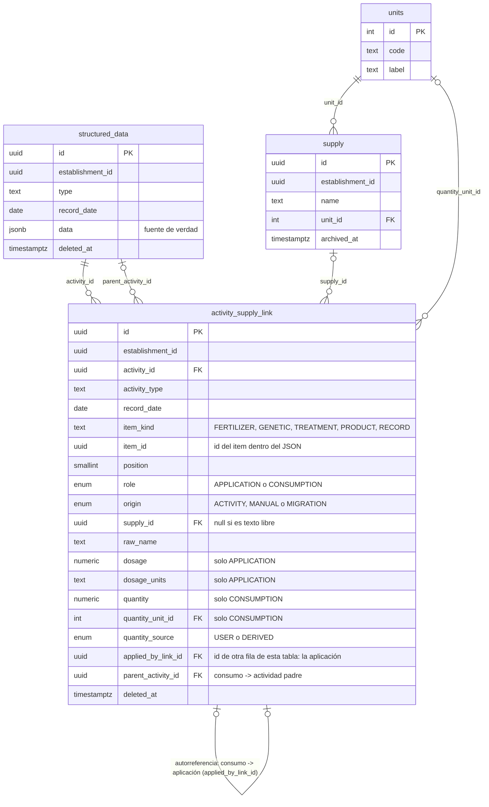
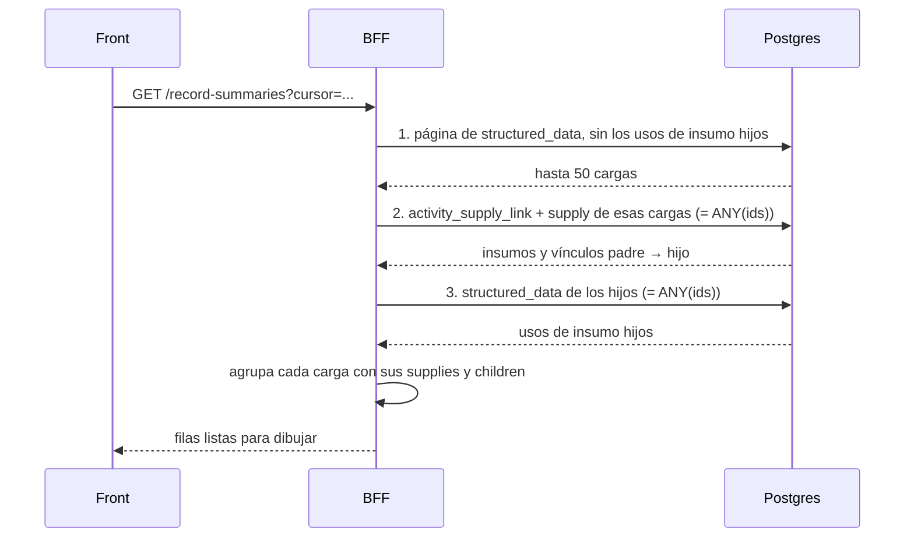

# Actividades e insumos

Modelo para relacionar las actividades de campo con los insumos que consumen, sobre structured data.

| Entregable | Dónde está |
|---|---|
| Modelo de datos de la relación: tablas, campos, tipo de relación, claves e índices | [`schema/001_activity_supply_link.sql`](schema/001_activity_supply_link.sql) y las secciones [Modelo](#modelo) y [Cambios en el JSON](#cambios-en-el-json) |
| Código ilustrativo del CRUD | Sección [CRUD](#crud) |
| Payloads de ejemplo de los 5 tipos de actividad | Sección [Payloads de ejemplo](#payloads-de-ejemplo) y [`payloads/01..05`](payloads/) |
| Mock de la respuesta nueva del tab Datos | Sección [Tab Datos](#tab-datos) y [`payloads/06_datos.json`](payloads/06_datos.json) |
| Decisiones de diseño y trade-offs | Este README, en especial [Trade-offs](#trade-offs) |

En los ejemplos los ids son legibles (`sd-fert-002`, `sup-urea`, `lnk-002-f0`), pero en la base son UUID. Unidades: 1 Litros, 2 Kilos, 5 Bolsas, 7 Mililitros.


## Idea general

El JSON de cada actividad sigue siendo la fuente de verdad. Lo que agrego es una tabla, `activity_supply_link`, con una fila por cada item que usa un insumo. Esa tabla se escribe en la misma transacción que el JSON y se puede regenerar a partir de él.

Así, preguntas como "qué insumos usó esta pulverización", "dónde se usó la Urea este año" o "de qué actividad salió este uso de insumo" se responden con consultas indexadas, sin abrir el JSON.

Elegí una proyección y no sacar los insumos del JSON porque hoy todo lo que carga datos (formularios, WhatsApp, cargas masivas) produce JSON. Con una tabla al costado, la migración es aditiva y reversible.


## Modelo



`activity_supply_link` es la única tabla nueva; las otras tres ya existen. Los FKs hacia `structured_data` y `supply` son compuestos e incluyen `establishment_id`, algo que el diagrama no llega a mostrar.

Cada fila tiene un `role`:

- `APPLICATION`: la actividad aplicó un insumo a una dosis. Sale de `fertilizers[]`, `details.genetic_variety`, `treatments[]` y `products[]`. No mueve stock.
- `CONSUMPTION`: salió una cantidad del inventario. Siempre es un record de un SUPPLYOUTPUT.

Separé los dos porque el formulario ya los separa. La dosis (2 L/ha) es el dato agronómico. La cantidad a descontar (50 L) la confirma el usuario en el bloque "Descontar del inventario", que es opcional: no siempre se descuenta (el producto puede ser del contratista, o haberse descontado antes) y, cuando se descuenta, no siempre es dosis × hectáreas.

Cuando una actividad descuenta, se genera un SUPPLYOUTPUT con su propio id, que es la fila hija que se ve en el feed. Su fila `CONSUMPTION` apunta a la `APPLICATION` que la originó (`applied_by_link_id`) y a la actividad (`parent_activity_id`). Un uso de insumo cargado a mano tiene su `CONSUMPTION` sin padre.

Algunas columnas:

- `item_id`: los items de los arrays no tienen identidad. Si el vínculo se atara a la posición, al borrar el primer producto todos los demás quedarían apuntando a otro. Por eso cada item del JSON lleva un `item_id`, que asigna el server y el cliente devuelve al editar. La genética es un único slot y usa un id fijo por actividad.
- `supply_id` puede ser null cuando el producto se escribió a mano. La fila existe igual, con el nombre en `raw_name`, para que esos items también se puedan consultar y vincular más adelante.
- `origin` dice cómo nació la fila: `ACTIVITY`, `MANUAL` (uso de insumo cargado a mano) o `MIGRATION` (vínculo confirmado sobre datos históricos).
- `quantity_source` dice si la cantidad la confirmó el usuario o la calculó el sistema.
- `activity_type`, `record_date` y `establishment_id` están copiados de la actividad para filtrar sin tocar `structured_data`.
- `deleted_at`: el borrado es lógico. Lo que se saca de una actividad queda como historial.

La base controla lo que no debería depender del código:

- Los FKs son compuestos con `establishment_id`, así un vínculo no puede apuntar a una actividad o un insumo de otro campo. El de la actividad incluye `activity_type` y `record_date`; con `ON UPDATE CASCADE`, si cambia la fecha de la actividad se actualiza en sus filas.
- El FK de `(applied_by_link_id, parent_activity_id)` obliga a que el padre de un consumo sea la actividad de la aplicación a la que apunta.
- Los CHECK fijan qué item corresponde a cada tipo de actividad, que una aplicación no tiene cantidad, que un consumo siempre tiene insumo, cantidad y unidad, y que un uso manual no tiene padre.
- Todos los FKs son `RESTRICT`. No se puede borrar físicamente una actividad que tiene vínculos.

Queda del lado del servicio que el insumo del consumo sea el mismo que el de su aplicación. Si hiciera falta asegurarlo en la base, iría un trigger.

Los índices de consulta son parciales sobre filas vivas, para que el historial no pese. Los que necesitan los FKs no pueden ser parciales, porque Postgres los chequea sin el filtro de `deleted_at`.

Los índices sobre `structured_data` se crean con `CONCURRENTLY` y la migración usa `lock_timeout`, porque es una tabla grande y compartida.


## Cambios en el JSON

Todos los campos nuevos tienen default, así que los documentos existentes siguen validando. Los campos que no se tocan quedan igual.

```python
class Deduction(BaseModel):
    quantity: float = Field(gt=0)                       # en la unidad del insumo


# plantation.py
class Details(BaseModel):
    genetic_variety: Optional[str] = None
    genetic_variety_supply_id: Optional[UUID] = None    # nuevo
    genetic_variety_deduction: Optional[Deduction] = None  # nuevo
    spacing: Optional[float] = None

class Fertilizer(BaseModel):
    item_id: UUID = Field(default_factory=uuid4)        # nuevo
    source: Optional[str] = None
    supply_id: Optional[UUID] = None                    # nuevo
    dosage: Optional[float] = None
    dosage_units: Optional[Literal["L/ha", "kg/ha"]] = None
    deduction: Optional[Deduction] = None               # nuevo


# fertilization.py
class Fertilizer(BaseModel):
    item_id: UUID = Field(default_factory=uuid4)        # nuevo
    source: str
    supply_id: Optional[UUID] = None                    # nuevo
    dosage: Optional[float] = None
    dosage_units: Optional[Literal["L/ha", "kg/ha"]] = None
    deduction: Optional[Deduction] = None               # nuevo


# pulverization.py
class Treatment(BaseModel):
    item_id: UUID = Field(default_factory=uuid4)        # nuevo
    source: str
    supply_id: Optional[UUID] = None                    # nuevo
    dosage: float
    dosage_units: Literal["L/ha", "g/ha", "kg/ha", "cc/ha"]
    deduction: Optional[Deduction] = None               # nuevo


# cattle.py
class TreatmentProduct(BaseModel):
    item_id: UUID = Field(default_factory=uuid4)        # nuevo
    name: Optional[str] = None
    supply_id: Optional[UUID] = None                    # nuevo
    dosage: Optional[float] = None
    dosage_units: Optional[Literal["ml", "cc", "g", "kg", "L"]] = None
    deduction: Optional[Deduction] = None               # nuevo


# supplies.py
class Record(BaseModel):
    item_id: UUID = Field(default_factory=uuid4)        # nuevo
    supply_id: Optional[str]
    quantity: float
    unit: Optional[int] = None
    source_item_id: Optional[UUID] = None               # nuevo
    quantity_source: Literal["USER", "DERIVED"] = "USER"  # nuevo

class SUPPLYOUTPUT(BaseStructure):
    basic_info: BasicInfo
    records: list[Record] = []
    source_activity_id: Optional[UUID] = None           # nuevo
    note: Optional[str] = None
```

- `item_id` lo asigna el server cuando falta, y el cliente lo devuelve al editar. La genética no lo necesita: es un solo valor por siembra.
- `supply_id` es el insumo elegido con "Seleccionar de inventario". Si es null, el producto se escribió a mano.
- `deduction` es el bloque "Descontar del inventario". Solo vale si hay `supply_id`.
- `source_activity_id` y `source_item_id` indican de qué actividad e item salió un uso de insumo. Si son null, se cargó a mano.


## Ejemplo

Es el caso de las capturas: una pulverización de camelina en el potrero Corral (25 ha), con 2,4-d a 2 L/ha y "Descontar del inventario" tildado con 50 litros. El mismo día hay un uso de Maíz cargado a mano.

Lo que carga el usuario:

```
Potrero    Corral                    Hectáreas  25
Producto   2,4-d (del inventario)    Dosis      2      Unidad  L/ha
  [x] Descontar del inventario       2,4-d                     50 Litros
```

Lo que queda en `structured_data`:

| id | type | contenido |
|---|---|---|
| sd-pulv-101 | PULVERIZATION | Corral 25 ha · 2,4-d · 2 L/ha · descontar 50 |
| sd-supply-102 | SUPPLYOUTPUT | 2,4-d · 50 L · actividad: sd-pulv-101 |
| sd-supply-090 | SUPPLYOUTPUT | Maíz · 64.000 kg · sin actividad |

Lo que queda en `activity_supply_link`:

| id | activity_id | role | origin | insumo | dosis | cantidad | aplicación | actividad padre |
|---|---|---|---|---|---|---|---|---|
| lnk-101-t0 | sd-pulv-101 | APPLICATION | ACTIVITY | 2,4-d | 2 L/ha | | | |
| lnk-102-r0 | sd-supply-102 | CONSUMPTION | ACTIVITY | 2,4-d | | 50 L | lnk-101-t0 | sd-pulv-101 |
| lnk-090-r0 | sd-supply-090 | CONSUMPTION | MANUAL | Maíz | | 64.000 kg | | |

Cómo se ve en el tab Datos:

```
Hoy   Se pulverizó camelina en el potrero "Corral", con el tratamiento 2,4-D (2 L/ha).
        ↳ Se utilizó el siguiente insumo en el potrero Corral: 2,4-d (50 Litros).
Hoy   Se utilizó el insumo Maíz (64.000 kilos).
```

El uso de 2,4-d aparece debajo de la pulverización porque `lnk-102-r0` tiene actividad padre. El de Maíz sigue como fila propia porque no tiene.

Si el usuario edita la pulverización y destilda "Descontar del inventario", `sd-supply-102` y `lnk-102-r0` quedan con `deleted_at`, `lnk-101-t0` no cambia y el inventario registra la devolución de los 50 litros. En el feed queda solo la pulverización.

Los ejemplos de los otros tipos de actividad están en `payloads/`.


## Payloads de ejemplo

Cada archivo tiene tres partes: el documento que se guarda en `structured_data` (lo que manda el formulario), el uso de insumo que se genera si hay descuento y las filas que quedan en `activity_supply_link`. Acá va un resumen de cada uno; el detalle completo está en el JSON.

### Siembra · [`01_plantation.json`](payloads/01_plantation.json)

Maíz DK7210 en Lote Norte, con Fosfato diamónico. Se descuentan 40 bolsas de semilla; el fertilizante no se descuenta.

```json
"details": {
  "genetic_variety": "DK7210",
  "genetic_variety_supply_id": "sup-dk7210",
  "genetic_variety_deduction": { "quantity": 40 }
},
"fertilizers": [
  { "item_id": "it-siembra-001-f0", "source": "Fosfato diamónico", "supply_id": "sup-fosfato-diamonico",
    "dosage": 100, "dosage_units": "kg/ha", "deduction": null }
]
```

| fila | role | insumo | dosis | cantidad | padre |
|---|---|---|---|---|---|
| lnk-001-f0 | APPLICATION | Fosfato diamónico | 100 kg/ha | | |
| lnk-001-gen | APPLICATION | DK7210 | 80.000 seeds/ha | | |
| lnk-776-r0 | CONSUMPTION | DK7210 | | 40 bolsas | sd-siembra-001 |

### Fertilización · [`02_fertilization.json`](payloads/02_fertilization.json)

Urea a 10 kg/ha en Lote Sur, con 100 kg descontados. Es el par `sd-fert-002` / `sd-supply-777` del enunciado, ahora vinculado.

```json
"fertilizers": [
  { "item_id": "it-fert-002-f0", "source": "Urea", "supply_id": "sup-urea",
    "dosage": 10, "dosage_units": "kg/ha", "deduction": { "quantity": 100 } }
]
```

| fila | role | insumo | dosis | cantidad | padre |
|---|---|---|---|---|---|
| lnk-002-f0 | APPLICATION | Urea | 10 kg/ha | | |
| lnk-777-r0 | CONSUMPTION | Urea | | 100 kg | sd-fert-002 |

### Pulverización · [`03_pulverization.json`](payloads/03_pulverization.json)

Glifosato a 2 L/ha escrito a mano, sin elegirlo del inventario. Queda el vínculo con `supply_id` null y no hay descuento posible.

```json
"treatments": [
  { "item_id": "it-pulv-003-t0", "source": "Glifosato", "supply_id": null,
    "dosage": 2, "dosage_units": "L/ha", "deduction": null }
]
```

| fila | role | insumo | dosis | cantidad | padre |
|---|---|---|---|---|---|
| lnk-003-t0 | APPLICATION | Glifosato (texto libre) | 2 L/ha | | |

### Tratamiento · [`04_treatment.json`](payloads/04_treatment.json)

Ivermectina a 5 ml por animal en 100 vaquillonas, con 500 ml descontados. Es el par `sd-trat-004` / `sd-supply-778` del enunciado.

```json
"products": [
  { "item_id": "it-trat-004-p0", "name": "Ivermectina", "supply_id": "sup-ivermectina",
    "dosage": 5, "dosage_units": "ml", "deduction": { "quantity": 500 } }
]
```

| fila | role | insumo | dosis | cantidad | padre |
|---|---|---|---|---|---|
| lnk-004-p0 | APPLICATION | Ivermectina | 5 ml | | |
| lnk-778-r0 | CONSUMPTION | Ivermectina | | 500 ml | sd-trat-004 |

### Uso de insumos suelto · [`05_supplyoutput.json`](payloads/05_supplyoutput.json)

Gasoil y aceite hidráulico cargados a mano, sin actividad. Las filas son `CONSUMPTION` con `origin = MANUAL` y sin padre.

```json
"source_activity_id": null,
"records": [
  { "item_id": "it-supply-779-r0", "supply_id": "sup-gasoil", "quantity": 200, "unit": 1 },
  { "item_id": "it-supply-779-r1", "supply_id": "sup-aceite-hidraulico", "quantity": 20, "unit": 1 }
]
```

| fila | role | insumo | dosis | cantidad | padre |
|---|---|---|---|---|---|
| lnk-779-r0 | CONSUMPTION | Gasoil | | 200 L | |
| lnk-779-r1 | CONSUMPTION | Aceite hidráulico | | 20 L | |


## CRUD

La actividad es dueña de sus insumos. Al crearla o editarla se recalculan sus vínculos y su uso de insumo derivado, todo en la misma transacción. El SUPPLYOUTPUT derivado solo lo escribe su actividad: si alguien intenta editarlo directamente, se responde 409 con el id de la actividad.

Las funciones reciben cualquier carga (`entry`): una actividad o un uso de insumo cargado a mano. El campo (`establishment_id`) sale de la sesión, nunca del payload, y todas las búsquedas lo usan. Si un usuario manda el id de una carga de otro campo, no la encuentra.

```python
def create_entry(establishment_id, type_, payload, user):
    authorize(user, establishment_id, "write")
    doc = parse(type_, payload)                         # asigna item_id a los items que no lo tengan
    if type_ == "SUPPLYOUTPUT" and doc.source_activity_id:
        raise Unprocessable("los usos de insumo de una actividad los crea la actividad")

    with transaction():
        validate_items(establishment_id, type_, doc)
        entry = insert_structured_data(establishment_id, type_, doc, user)
        apply_relation(entry, user)
        if type_ == "SUPPLYOUTPUT":
            emit("stock.output_created", entry.id)
    return entry


def update_entry(establishment_id, entry_id, payload, user):
    authorize(user, establishment_id, "write")
    with transaction():
        entry = lock(establishment_id, entry_id)        # SELECT ... FOR UPDATE, solo cargas vivas
        if entry.is_derived_supply_output:
            raise Conflict(parent=entry.source_activity_id)

        doc = parse(entry.type, payload)
        validate_items(establishment_id, entry.type, doc)
        entry = replace_structured_data(entry, doc, user)
        apply_relation(entry, user)
        if entry.type == "SUPPLYOUTPUT":
            emit("stock.output_updated", entry.id)
    return entry


def delete_entry(establishment_id, entry_id, user):
    authorize(user, establishment_id, "write")
    with transaction():
        entry = get_alive(establishment_id, entry_id)

        if entry.is_derived_supply_output:
            # borrar la fila hija en el feed = dejar de descontar en la actividad
            parent = lock(establishment_id, entry.source_activity_id)   # padre antes que hijo
            return update_entry(establishment_id, parent.id, without_deductions(parent.data), user)

        entry = lock(establishment_id, entry_id)
        if entry.type != "SUPPLYOUTPUT":
            output = find_supply_output(establishment_id, entry.id)
            if output:
                soft_delete(output, user)
        soft_delete(entry, user)


def apply_relation(entry, user):
    items = extract_items(entry.type, entry.data)
    if entry.type == "SUPPLYOUTPUT":
        sync_links(entry, items, origin="MANUAL", user=user)
    else:
        sync_links(entry, items, origin="ACTIVITY", user=user)
        sync_supply_output(entry, items, user)


def sync_links(entry, items, origin, user, parents=None):
    current = {link.item_id: link for link in alive_links(entry.establishment_id, entry.id)}
    wanted = {item.item_id: item for item in items}

    for item_id in current.keys() - wanted.keys():
        soft_delete_link(current[item_id], user)

    for item in wanted.values():
        parent = parents.get(item.source_item_id) if parents else None
        upsert_link(entry, item, origin, parent)
        # INSERT ... ON CONFLICT (activity_id, item_id) WHERE deleted_at IS NULL DO UPDATE
        # establishment_id, activity_type y record_date salen de entry, nunca del payload


def sync_supply_output(activity, items, user):
    to_deduct = [i for i in items if i.deduction]
    output = find_supply_output(activity.establishment_id, activity.id)

    if not to_deduct:
        if output:
            soft_delete(output, user)
        return

    supplies = get_supplies(activity.establishment_id, [i.supply_id for i in to_deduct])
    doc = SupplyOutput(
        basic_info=BasicInfo(
            record_date=activity.record_date,
            lote=", ".join(activity.lote_names) or None,
        ),
        source_activity_id=activity.id,
        records=[
            Record(
                item_id=existing_record_id(output, i.item_id) or new_id(),
                supply_id=i.supply_id,
                quantity=i.deduction.quantity,
                unit=supplies[i.supply_id].unit_id,
                source_item_id=i.item_id,
            )
            for i in to_deduct
        ],
    )

    if output:
        output = replace_structured_data(output, doc, user)
        emit("stock.output_updated", output.id)
    else:
        output = insert_structured_data(activity.establishment_id, "SUPPLYOUTPUT", doc, user)
        emit("stock.output_created", output.id)

    parents = {link.item_id: link for link in alive_links(activity.establishment_id, activity.id)}
    sync_links(output, extract_items("SUPPLYOUTPUT", doc), origin="ACTIVITY", user=user, parents=parents)


def soft_delete(entry, user):
    mark_deleted(entry, user)                           # deleted_at / deleted_by en structured_data
    soft_delete_links(entry.establishment_id, entry.id, user)
    if entry.type == "SUPPLYOUTPUT":
        emit("stock.output_voided", entry.id)           # el inventario registra la reversa


def validate_items(establishment_id, type_, doc):
    items = extract_items(type_, doc)
    if has_duplicates(i.item_id for i in items):
        raise Unprocessable("item_id repetido")

    supplies = get_supplies(establishment_id, [i.supply_id for i in items if i.supply_id])
    for i in items:
        if i.supply_id and i.supply_id not in supplies:
            raise Unprocessable("el insumo no existe en este campo")
        if i.deduction and not i.supply_id:
            raise Unprocessable("no se puede descontar un producto escrito a mano")
```

## Tab Datos

Forma de cada fila de la respuesta:

```
data[]
└── fila de nivel superior (actividad o uso de insumo suelto)
    ├── campos de antes: record_locator, detail, summary, structure…
    ├── supplies[]   insumos de la actividad: dosis y, si hubo descuento, cuánto (consumed)
    └── children[]   usos de insumo derivados: la fila hija del feed
```

El mock completo está en [`payloads/06_datos.json`](payloads/06_datos.json) y parte del «antes» del enunciado. Así queda una de las filas:

```json
{
  "record_locator": "sd-fert-002",
  "table_name": "structured_data",
  "detail": "FERTILIZATION",
  "record_date": "2026-03-12",
  "summary": "Fertilización — Lote Sur — Urea 10 kg/ha",
  "structure": { "name": "Fertilización", "lote_names": ["Lote Sur"], "keys": { "Cultivo": "Trigo", "Fertilizante": "Urea", "Dosis": "10 kg/ha" } },
  "parent_record_locator": null,
  "supplies": [
    {
      "link_id": "lnk-002-f0",
      "kind": "FERTILIZER",
      "name": "Urea",
      "supply": { "id": "sup-urea", "name": "Urea", "unit": "Kilos", "photo_url": "https://cdn.example/sup-urea.jpg" },
      "dosage": { "value": 10, "units": "kg/ha" },
      "consumed": { "quantity": 100, "unit": "Kilos", "record_locator": "sd-supply-777" }
    }
  ],
  "children": [
    {
      "record_locator": "sd-supply-777",
      "table_name": "structured_data",
      "detail": "SUPPLYOUTPUT",
      "relation": "SUPPLY_CONSUMPTION",
      "record_date": "2026-03-12",
      "summary": "Se utilizó el siguiente insumo en el potrero Lote Sur: Urea (100 kg)",
      "parent_record_locator": "sd-fert-002",
      "actions": { "edit": "parent", "delete": "stop_deduction" }
    }
  ]
}
```

Comparado con el «antes», cada actividad trae sus insumos en `supplies` y su uso de insumo en `children`. Los SUPPLYOUTPUT que tienen actividad ya no aparecen como filas propias; los cargados a mano sí, como el de gasoil del ejemplo.

Lo armé anidado para que el front lo dibuje tal como llega, sin agrupar. Con una lista plana y referencias, el front tendría que juntar padre e hijo, y si caen en páginas distintas el agrupamiento se rompe. Por el mismo motivo, `total` cuenta solo las filas de nivel superior.

`supplies` trae el insumo resuelto (nombre, unidad, foto, dosis y cuánto se descontó). `supply: null` indica que el producto se escribió a mano. `children` trae la fila hija con su propio id, y `actions` le indica al front que editarla abre la actividad y borrarla apaga el descuento.



La respuesta se arma con tres consultas por página, sin importar cuántas filas tenga: la página, los vínculos de todas esas filas juntos (`= ANY(ids)`) y los usos de insumo hijos juntos. La página se pide por cursor `(record_date, id)`:

```sql
SELECT sd.*
FROM structured_data sd
WHERE sd.establishment_id = $1
  AND sd.deleted_at IS NULL
  AND NOT EXISTS (
      SELECT 1 FROM activity_supply_link l
      WHERE l.activity_id = sd.id
        AND l.parent_activity_id IS NOT NULL
        AND l.deleted_at IS NULL
  )
  AND (sd.record_date, sd.id) < ($2, $3)
ORDER BY sd.record_date DESC, sd.id DESC
LIMIT 50;
```


## Trade-offs

- **Una tabla más para mantener.** `activity_supply_link` da velocidad de lectura: las preguntas sobre insumos se responden sin abrir el JSON. El costo es que el JSON y la tabla se pueden desincronizar. Por eso se escriben en la misma transacción, y si algo falla, la tabla se regenera desde el JSON.
- **Escribir todo junto en vez de después.** La tabla se actualiza en la misma transacción que el JSON, así que el feed nunca muestra una actividad sin su uso de insumo. A cambio, guardar tarda un poco más que si se hiciera después con un evento.
- **Una sola tabla para aplicaciones y consumos.** Las consultas como "todo lo que pasó con la Urea" salen de un lugar y con un índice. A cambio, algunas columnas quedan vacías según el tipo de fila, y hay que controlar con CHECKs que cada tipo llene las suyas.
- **Un `item_id` en cada producto.** Reordenar o borrar un producto no rompe los vínculos de los demás. A cambio, el cliente tiene que devolver el `item_id` al editar; si no lo hace, el servidor trata todos los productos como nuevos.
